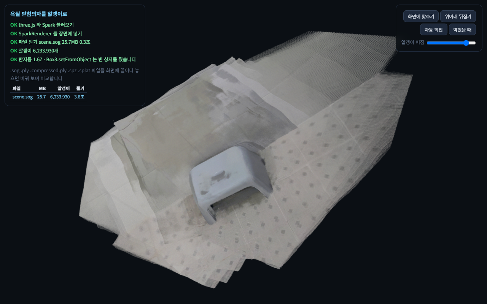

# 욕실 받침의자를 알갱이로

폰으로 찍은 영상 하나를 MapAnything 으로 복원해 가우시안 스플랫으로 바꾸고, three.js 와 Spark 로 브라우저에 띄웠습니다.

- 보기: https://xktkf147.github.io/room-3d-scene/
- 장면 파일: https://xktkf147.github.io/room-3d-scene/scene.sog

## 고른 공간과 공개해도 되는 이유

집 욕실 바닥에 놓인 플라스틱 받침의자 하나만 찍었습니다. 화면에 담긴 것은 벽 타일, 바닥 타일, 받침의자뿐입니다.
얼굴, 문패, 창밖 풍경, 우편물처럼 사람이나 위치를 알 수 있는 정보는 없습니다. 그래서 공개 저장소에 올렸습니다.

## 촬영

| 항목 | 값 |
|---|---|
| 촬영한 부분 | 욕실 구석 바닥의 받침의자와 그 뒤 두 벽면 |
| 걸은 경로 | 받침의자 왼쪽 앞에서 시작해, 의자를 바라본 채 오른쪽 앞으로 호를 그리며 걸었습니다 |
| 영상 길이 | 15.9초 |
| 해상도 | 1080 × 1080 (정사각형), 30fps, 477프레임 |
| 추출한 프레임 | 24장 (영상 전체에서 고르게 추출, 긴 변 1024로 축소) |
| 모델 입력 크기 | 518 × 518 |

## 복원

Google Colab Tesla T4 에서 `facebook/map-anything-apache` 로 복원했습니다. T4 에는 bf16 이 없어서 fp16 으로 계산했습니다.

| 항목 | 값 |
|---|---|
| 복원 시간 | 22.4초 |
| 최대 GPU 메모리 | 8.10GB |
| 점 개수 (원본) | 6,367,630 |
| 점 개수 (축별 0.5~99.5 백분위 밖 제거 후) | 6,233,930 |
| 카메라 위치 상자 대각선 / 장면 상자 대각선 | 1.113 / 3.350 |
| **카메라 퍼짐 비** | **0.332** |

### 실제 촬영 경로와 비교

퍼짐 비가 0.332 로, 제자리에서 몸만 돌렸을 때 나오는 0.1 미만보다 훨씬 큽니다. 걸어 다니며 찍은 것이 수치로도 드러납니다.

복원된 카메라 24개를 이어 보면 이렇습니다.

- 카메라는 이동 거리 1.77, 시작점과 끝점 사이 직선거리 1.11 만큼 움직였습니다. 단위는 모델 단위이고 대략 m 입니다.
- 바라보는 방향은 처음에서 끝까지 약 59° 돌았습니다. 수평으로는 약 55° 입니다.
- 화살표는 처음부터 끝까지 받침의자 쪽을 향합니다.

의자를 바라보며 왼쪽 앞에서 오른쪽 앞으로 호를 그렸다는 위 경로와 맞습니다.

[빈칸: 내가 실제로 걸은 경로와 위 결과가 맞는지 한두 문장으로 적기]

카메라 한 걸음(프레임 사이 이동)은 처음 9장에서 0.03~0.06 이었습니다. 10번째 장부터는 0.07~0.14 로 두 배 가까이 커집니다. 영상 중간에 빨리 걸었다는 뜻입니다.

## 형식 비교

같은 `scene.ply` 를 `npx -y @playcanvas/splat-transform@3.10.3 -w` 로 세 형식으로 바꿨습니다.

- **변환 시간:** 도구가 출력한 처리 시간입니다. 괄호 안은 npx 시작까지 포함한 전체 시간입니다.
- **크기 단위:** MB 는 1,000,000 바이트, MiB 는 1,048,576 바이트 기준입니다.

| 형식 | 크기 (바이트) | MB / MiB | 변환 시간 | 알갱이 개수 | 알갱이당 바이트 | 원본 대비 |
|---|---:|---:|---:|---:|---:|---:|
| `.ply` (원본) | 423,907,657 | 423.9 / 404.3 | — | 6,233,930 | 68.00 | 1배 |
| `.compressed.ply` | 101,496,886 | 101.5 / 96.8 | 11.7초 (22.7초) | 6,233,930 | 16.28 | 4.2배 |
| `.sog` | 26,981,514 | 27.0 / 25.7 | 14.1초 (20.3초) | 6,233,930 | 4.33 | 15.7배 |
| `.spz` | 33,997,746 | 34.0 / 32.4 | 24.4초 (30.3초) | 6,233,930 | 5.45 | 12.5배 |

**알갱이 개수 확인:** 네 파일 모두 6,233,930개입니다.

- 파일 안의 정보로 셌습니다. PLY 두 개는 헤더의 `element vertex`, `.sog` 는 `meta.json` 의 `count`, `.spz` 는 헤더의 `numPoints` 를 읽었습니다.
- 뷰어에 네 파일을 하나씩 끌어다 놓았을 때 Spark 가 센 개수도 같았습니다.

**올린 파일:** 공개 페이지에는 가장 작은 `.sog` 만 올렸습니다. 비교용 파일은 저장소에 올리지 않았습니다. 원본 `.ply` 는 GitHub 의 파일 하나당 한도 100MiB 를 넘습니다.

**뷰어 버전:** `.spz` 는 splat-transform 3.10.3 이 새 형식(v4, 헤더가 `NGSP`)으로 씁니다. Spark 2.1.0 은 이 파일을 열지 못했습니다(`Invalid gzip header`). 그래서 뷰어를 Spark 2.4.0 으로 올렸습니다. 2.4.0 에서는 네 형식이 모두 열렸고, `.sog`(SOG v2)도 그대로 읽혔습니다.

## 뷰어

- 마우스로 끌면 돌아가고, 휠로 확대·축소합니다.
- `.sog`, `.ply`, `.compressed.ply`, `.spz`, `.splat` 파일을 화면에 끌어다 놓으면 그 파일로 바뀝니다. 왼쪽 위 표에 파일 이름, 크기, 알갱이 개수, 푸는 데 걸린 시간이 한 줄씩 쌓입니다.
- 끌어다 놓은 파일은 서버로 가지 않고 브라우저 안에서만 열립니다.
- Spark 의 `SplatMesh({ fileBytes, fileType })` 에 넘기는 형식 이름은 확장자로 정합니다.
  - `.sog` 는 `pcsogszip` 입니다.
  - `.ply` 와 `.compressed.ply` 는 둘 다 `ply` 입니다. Spark 가 안에서 압축판을 알아봅니다.
  - `.spz` 는 `spz`, `.splat` 은 `splat` 입니다.

## 첫 화면까지 걸린 시간

주소를 연 뒤 받침의자가 처음 보일 때까지 걸린 시간입니다.

| 기기 | 브라우저 | 통신 환경 | 첫 화면까지 |
|---|---|---|---|
| 내 폰: 갤럭시 S22+ | 크롬 | 와이파이 | 2.2초 |
| 다른 폰: 아이폰 17 | 카카오톡 내장 브라우저 | 와이파이 | 0.6초 |

## 잘 보이는 방향과 구멍·잡티가 보이는 방향

**잘 보이는 방향.** 촬영한 쪽, 곧 의자 앞쪽 위에서 비스듬히 내려다보는 방향이 가장 깨끗합니다.

- 받침의자 윗면과 손잡이 구멍, 앞쪽 다리, 바닥 타일의 점무늬가 또렷합니다.
- 의자와 그 앞 바닥은 24장 거의 모두에 찍혔고, 카메라가 의자를 중심으로 약 55° 돌았습니다.
- 그래서 같은 지점을 여러 각도에서 본 셈이라 시차가 충분했고, 깊이가 잘 맞았습니다.

**구멍과 잡티가 보이는 방향.** 세 가지가 있습니다.

1. **벽 쪽이나 의자 뒤에서 보면 구멍이 납니다.**
   - 원본 영상에서 카메라는 늘 의자 앞쪽 위에 있었습니다.
   - 의자 뒷면, 의자와 벽 사이 틈, 의자 밑 바닥은 한 번도 찍히지 않았습니다.
   - 본 적 없는 면이라 점이 없고, 옆이나 뒤로 돌리면 의자가 속이 빈 껍데기처럼 보입니다.
2. **옆에서 낮게 보면 벽과 바닥이 여러 겹으로 보입니다.**
   - 겹친 종이처럼 얇은 층이 겹쳐 보입니다.
   - 이 모델은 사진마다 깊이를 따로 구해 한 좌표계에 맞춥니다. 사진 사이 정렬이 조금 어긋나면 같은 벽이 사진 수만큼 살짝 다른 위치에 놓입니다.
   - 원본 영상을 보면 중간 부분(추출 프레임 10~19번, 영상 약 7~13초)에서 빨리 걸었습니다. 이 구간은 카메라 한 걸음이 앞부분의 두 배 가까이 됩니다.
   - 그 구간 사진은 움직임 때문에 번져 있습니다. 선명도 점수(라플라시안 분산)가 앞 10장 평균 약 16 에서 이 구간 2~9 로, 절반 이하로 떨어졌습니다.
   - 벽과 바닥이 비슷한 타일 무늬의 반복이라, 번진 사진에서는 어느 타일이 어느 타일인지 짝짓기가 더 어렵습니다. 이것이 정렬 오차로 이어진 것으로 봅니다.
3. **장면 가장자리(벽 위쪽, 먼 바닥)에 빗살 모양 잡티가 있습니다.**
   - 이 부분은 사진 몇 장의 가장자리에만 걸렸습니다.
   - 본 각도 차이(시차)가 작아서 깊이가 불확실하고, 사진 테두리의 점이 길게 늘어진 줄무늬로 남았습니다.

더 깨끗하게 하려면 두 가지가 필요합니다.

- 중간 구간을 천천히 걸어 번짐을 줄입니다.
- 의자 옆과 뒤쪽 벽까지 돌아가며 찍어 본 각도를 넓힙니다.

## 만든 과정

1. Colab T4 에서 MapAnything 으로 24장 복원 (fp16)
2. 축별 0.5~99.5 백분위 밖 점 제거
3. 점을 알갱이로 바꿈
   - 반지름 `r = 1.4 × 장면의 가장 긴 변 / √N`, 불투명도 0.9
   - 각도별 색 45칸은 빼서 알갱이당 68바이트
   - y, z 부호를 뒤집어 three.js 좌표에 맞춤
4. `splat-transform@3.10.3` 으로 `.sog` 변환
5. three.js 0.185.1 과 Spark 2.4.0 으로 표시

쓴 것: MapAnything (Apache-2.0), three.js (MIT), Spark (MIT), splat-transform (MIT).
